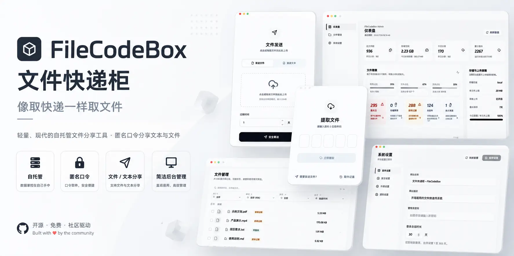
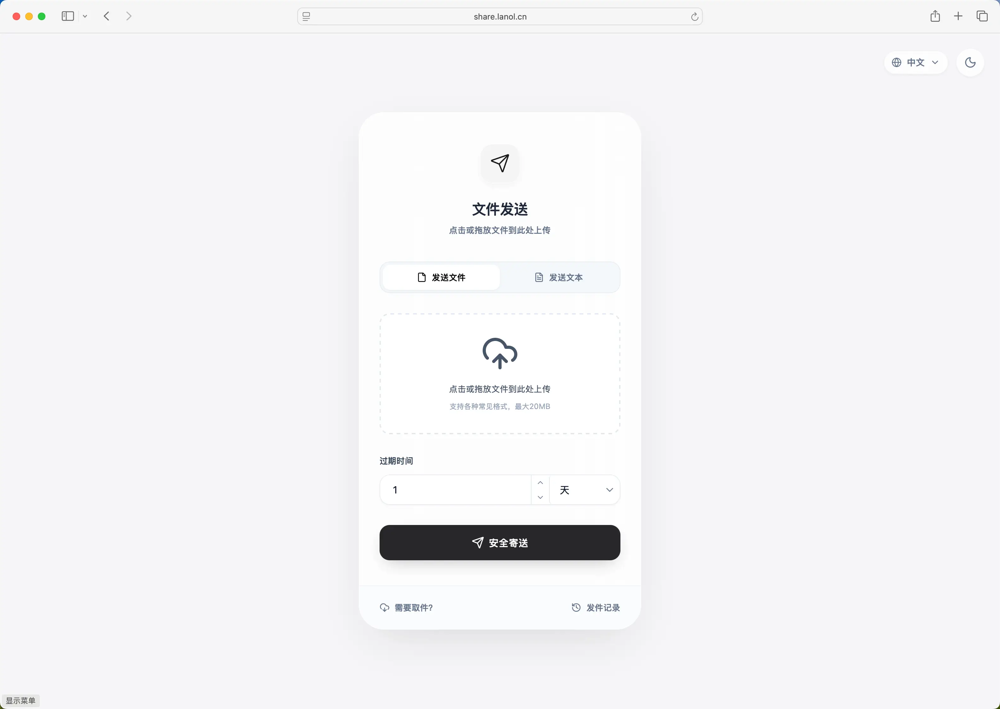
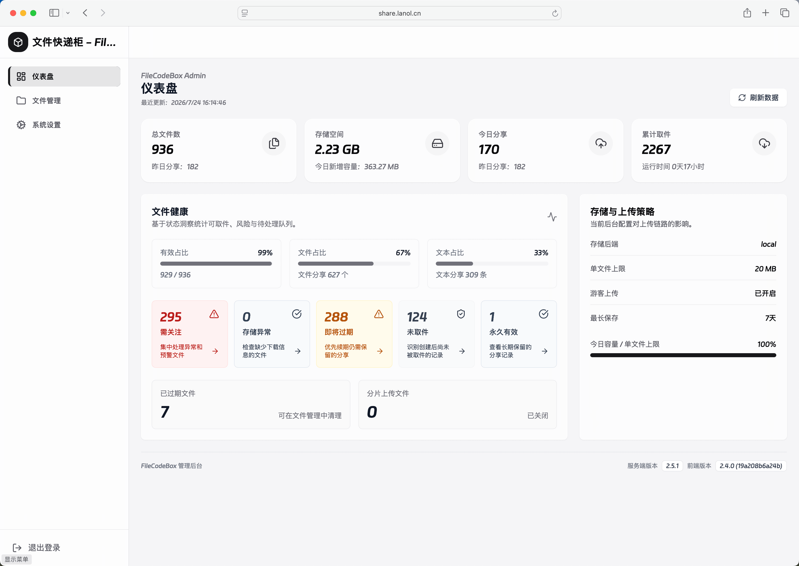
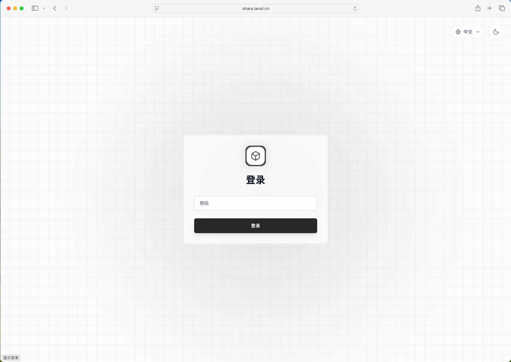
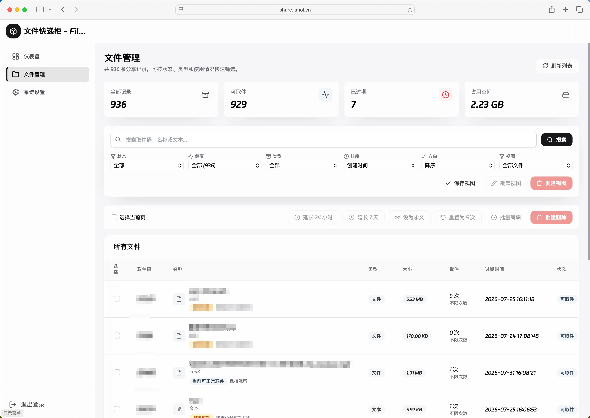
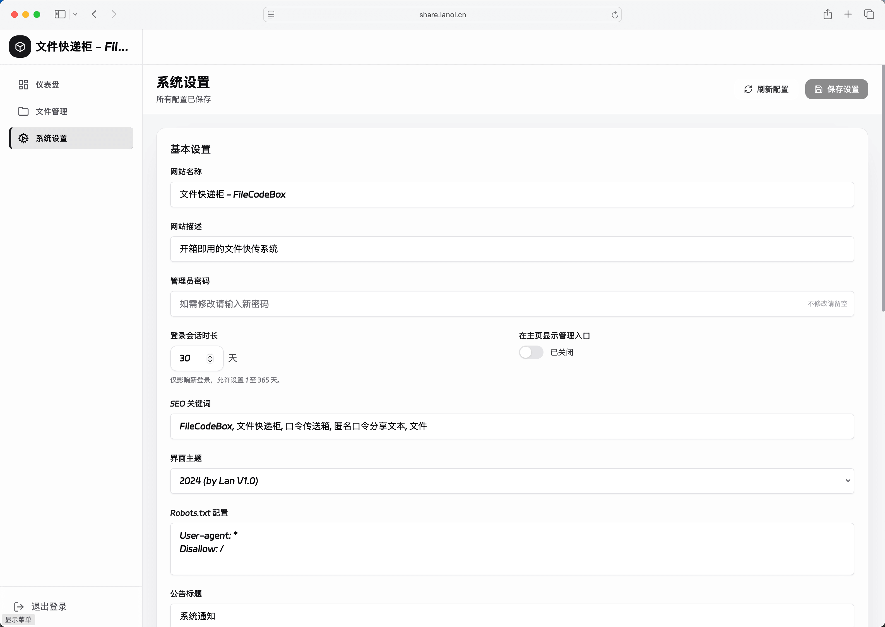

<div align="center">


# FileCodeBox

### 像取快递一样取文件

一个轻量、现代的自托管文件分享工具。无需注册，上传后获得口令，对方输入即可取件。

[在线演示](https://share.lanol.cn)　·　[使用文档](https://fcb-docs.aiuo.net/)　·　[English](./readme_en.md)

[](https://github.com/vastsa/FileCodeBox/releases/latest)
[](https://hub.docker.com/r/lanol/filecodebox)
[](https://github.com/vastsa/FileCodeBox/stargazers)
[](./LICENSE)

<br />



</div>

## 一条命令开始

```bash
docker run -d --restart unless-stopped \
  -p 12345:12345 \
  -v ./data:/app/data \
  -e APP_ENV=production \
  -e LOG_LEVEL=warning \
  --log-opt max-size=10m \
  --log-opt max-file=3 \
  --name filecodebox \
  lanol/filecodebox:2.8.3 # x-release-please-version
```

访问 `http://localhost:12345`，完成首次初始化。生产环境建议固定版本号；`latest` 指向最新正式版。
## AI 客户端与 MCP

FileCodeBox 支持 **MCP Streamable HTTP**，可从兼容的 AI 客户端创建文本和文件分享。服务端点为 `http://<你的服务器地址>:12345/mcp`（本机部署可用 `http://localhost:12345/mcp`），默认无需 Token。工具包括 `share_text` 和 `share_file`。若关闭游客上传或启用 MCP Token 校验，客户端需配置 `Authorization: Bearer <管理员 Token>`。

详见 [MCP 接入指南](https://fcb-docs.aiuo.net/guide/mcp)。

## 简单，但足够强大

<table>
<tr>
<td width="33%" valign="top"><b>即传即取</b><br /><sub>文件与文本统一分享，支持拖拽、粘贴、批量与分片上传。</sub></td>
<td width="33%" valign="top"><b>按需失效</b><br /><sub>按时间、取件次数或永久保存，自动清理过期内容。</sub></td>
<td width="33%" valign="top"><b>数据自主</b><br /><sub>本地、S3、OneDrive、WebDAV 与 OpenDAL，数据留在自己的基础设施。</sub></td>
</tr>
</table>

## 从分享，到管理

<table>
<tr>
<td width="50%"></td>
<td width="50%"></td>
</tr>
</table>

<table>
<tr>
<td width="33%"></td>
<td width="33%"></td>
<td width="33%"></td>
</tr>
</table>

<div align="center">

`FastAPI`　`Vue 3`　`SQLite`　`Docker`　`S3`　`WebDAV`　`Dark Mode`

</div>

## 继续了解

- [快速开始](https://fcb-docs.aiuo.net/guide/getting-started) · 部署、初始化与升级
- [存储配置](https://fcb-docs.aiuo.net/guide/storage) · 本地与对象存储
- [安全设置](https://fcb-docs.aiuo.net/guide/security) · 限流、会话与访问保护
- [API 文档](https://fcb-docs.aiuo.net/api/) · 上传、取件与管理接口
- [前端源码](https://github.com/vastsa/FileCodeBoxFronted) · 当前 2024 主题

## 参与项目

欢迎 [提交 Issue](https://github.com/vastsa/FileCodeBox/issues/new/choose) 或 Pull Request。项目基于 [LGPL-3.0](./LICENSE) 发布。

## 免责声明

本项目仅供合法的文件与文本分享场景使用。请勿上传、存储或传播违法、侵权或未经授权的内容；使用者应自行承担部署、数据合规与内容管理责任。

<div align="center">

**如果 FileCodeBox 对你有帮助，欢迎点亮一个 Star。**

</div>
